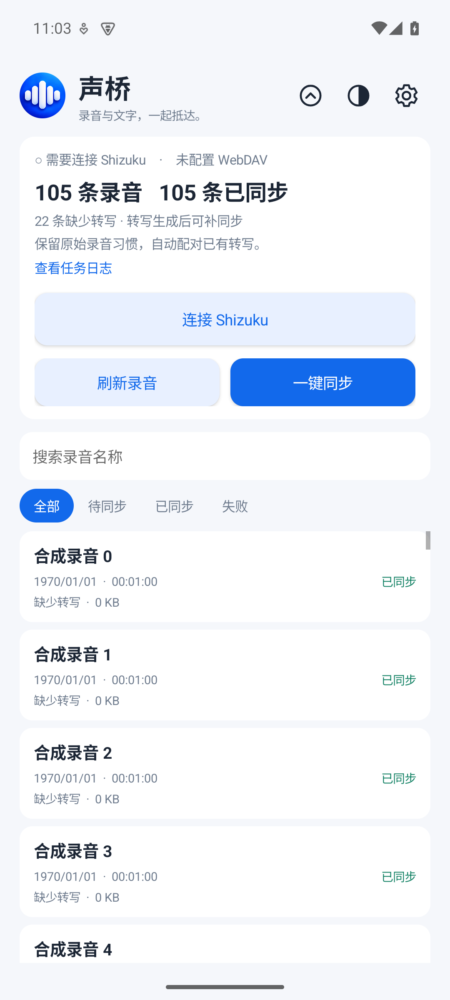
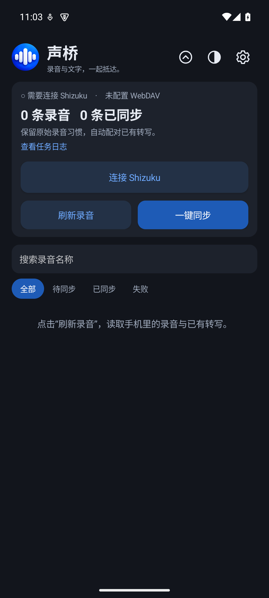
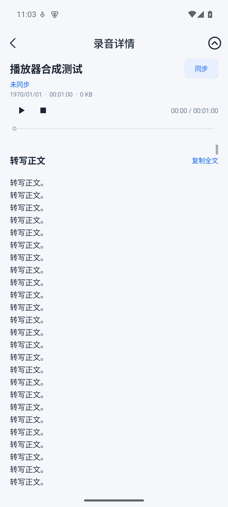

<div align="center">

# 小米声桥 (ShengQiao)

**保留小米系统录音习惯，把录音和转写自动同步到你自己的 WebDAV / NAS / Obsidian。**

[](LICENSE)
[]()
[]()
[]()
[](https://github.com/yuhuotech/shengqiao/releases/latest)
[](https://github.com/yuhuotech/shengqiao/actions/workflows/release.yml)

Kotlin 原生 Android 应用，配合 [Shizuku](https://shizuku.rikka.app/) 直接读取小米录音机和本地转写，
上传到任意 WebDAV 服务器，并按月归档一份 Markdown 到 Obsidian 仓库。

</div>

## 目录

- [背景](#背景)
- [特性](#特性)
- [界面预览](#界面预览)
- [架构](#架构)
- [快速开始](#快速开始)
- [构建与签名](#构建与签名)
- [发布流程](#发布流程)
- [开发与测试](#开发与测试)
- [项目结构](#项目结构)
- [贡献](#贡献)
- [许可](#许可)

## 背景

小米录音机的转写文本在系统沙箱里，普通 APP 拿不到；每次新录音都要手动分享再上传到 NAS，
很麻烦。本项目借助 [Shizuku](https://shizuku.rikka.app/) 用 shell 权限调用小米的本地备份接口，
批量拿到全部录音和转写，再通过 WebDAV 同步到你自己的服务器。

> 不会上传任何数据到第三方服务器。所有文件只在你配置的目标地址之间流动。

## 特性

- **自动发现录音与转写**：以 shell 身份调用小米本地备份（MiuiBackup）一次性获取录音列表、转写片段和摘要，读取原始音频文件。
- **内容身份 + 改名**：用实际文件 SHA-256 作为唯一标识，重命名后通过 WebDAV `MOVE` 改名而不重新上传；稳定 ID 保留同步记录。
- **WebDAV / NAS 同步**：支持 `Basic` 与 `Digest` 鉴权，HTTPS + 系统证书，可选 HTTP 出口；连接测试、错误诊断、失败重试。
- **双目录输出**：主目录 `/shengqiao` 保存音频、文本 JSON、摘要和元数据；Obsidian 目录 `/obsidian/小米录音/YYYYMM/录音名.md` 按录音创建月份归档。
- **可断点恢复**：上传到临时名后再 `MOVE` 覆盖正式名；任务被系统杀掉后重启仍会补全。
- **三种外观模式**：跟随系统 / 深色 / 浅色；首页同步面板、详情页头部可滚动收展，并保留手动展开入口。
- **轻量定时自动同步**：可关闭；开启后系统约每小时调度，仅在非按流量计费的 Wi-Fi 且电量充足时检测，有增量才上传。
- **搜索 + 筛选**：按名称搜索、全部 / 待同步 / 已同步 / 失败筛选，离线也能用。
- **凭据加密**：WebDAV 账号密码使用 Android Keystore 加密后保存，不在 SharedPreferences 中明文出现。

## 界面预览

> 截图存放于 [docs/previews](docs/previews/)。

| 首页（浅色）                       | 首页（深色）                       | 详情 + 播放器                       |
| ---------------------------------- | ---------------------------------- | ---------------------------------- |
|  |  |  |

## 架构

```
Xiaomi Recorder App
        │
        │  Shizuku UserService (shell UID)
        ▼
┌────────────────────────────┐
│  cn.shengqiao.bridge        │  AIDL: IRecorderBridge
│  - exportMetadata()         │  → MiuiBackup feature=3
│  - openAudio(path)          │  → FD 直接读取原始音频
│  - fileInfo(path)           │
└─────────────┬──────────────┘
              │
              ▼
┌────────────────────────────┐
│  MainActivity / UI          │  首页列表、搜索、筛选、详情、播放器
└─────────────┬──────────────┘
              │
              ▼
┌────────────────────────────┐
│  SyncService                │  扫描 + 优先级上传队列
│  AutoSyncJobService         │  JobScheduler 周期唤醒
└─────────────┬──────────────┘
              │
              ▼
┌────────────────────────────┐
│  WebDAV (okhttp3)           │  PUT → MOVE；Obsidian 目录另存 Markdown
└────────────────────────────┘
```

关键点：

- 读取音频使用 ParcelFileDescriptor，不会把文件复制到应用私有目录。
- SQLite 记录每条录音、每个目的地（destination）的同步状态，互不串扰。
- 签名使用 APK Signature Scheme v3；升级可保证签名一致。

## 快速开始

> 前置条件：Android 13+ 的小米 / 国产 ROM 手机，已安装并启动 [Shizuku 13.6+](https://shizuku.rikka.app/download/)，准备一个 WebDAV 服务（NAS、自建 Nextcloud、坚果云等都可以）。

1. 在 [Releases](https://github.com/yuhuotech/shengqiao/releases/latest) 下载 `xiaomi-shengqiao-release-v版本号.apk`，安装到手机。
2. 打开「小米声桥」→ 顶部「设置」→「同步服务器」，填写 WebDAV 地址 / 账号 / 密码。
   - 主同步目录默认 `/shengqiao`，Obsidian 转写目录默认 `/obsidian/小米录音`，都可改。
   - 点「测试连接」会先登录、创建目录、写读回、清理验证文件，全过才提示「连接成功」。
3. 返回首页 → 「连接 Shizuku」→ 同意授权。
4. 「刷新录音」会一次性把本地录音和转写导入并展示在首页。
5. 「一键同步」上传全部；或者点进某条录音，在详情页右上角「同步」单独补传（即使有自动同步在跑，单条也会立即执行）。

## 检查应用更新

在「设置」→「应用更新」中选择是否使用国内 GitHub 代理，点击「检查更新」。发现新版本后，需点击「更新」才会下载；下载完成后按系统提示允许安装并确认覆盖安装。应用不会自动检查或自动安装新版本。

启用代理时，版本查询和安装包下载会依次尝试 `gh-proxy.com`、`gh-proxy.org` 和 `gh.llkk.cc`，代理为第三方服务，可能不可用或发生变化。下载完成后会核对 Release 提供的文件大小和 SHA-256，并检查包名、版本与已安装应用的签名；Android 安装器还会进行安装校验。请使用相同签名覆盖安装，不要先卸载旧版本。

## 构建与签名

### 本地调试

```bash
export ANDROID_HOME=/path/to/android-sdk
./gradlew :app:assembleDebug :app:testDebugUnitTest :app:lintDebug
adb -s <serial> install -r app/build/outputs/apk/debug/app-debug.apk
```

### Release（生产签名）

密钥一旦发布就不能丢；建议先在本地生成并妥善备份。

```bash
# 1. 生成 keystore（默认密码 shengqiao2026，请改）
./tools/init-keystore.sh

# 2. 把密码写到 ~/.gradle/gradle.properties
cat >> ~/.gradle/gradle.properties <<EOF
SHENGQIAO_STORE_PASSWORD=...
SHENGQIAO_KEY_ALIAS=shengqiao
SHENGQIAO_KEY_PASSWORD=...
EOF

# 3. 构建
./tools/release.sh
# 产物在 app/build/outputs/apk/release/app-release.apk 和 app/build/outputs/bundle/release/app-release.aab
```

`tools/release.sh` 还会用 `apksigner verify` 检查签名，并打印 SHA-256。

## 发布流程

`.github/workflows/release.yml` 在推送 `v*` tag 时自动：

1. 在 Ubuntu + JDK 17 上装配 `assembleRelease` + `bundleRelease`。
2. 从 GitHub Secrets 读取 keystore 与密码进行 v3 签名。
3. 用 `apksigner verify` 校验。
4. 通过 `softprops/action-gh-release@v2` 把 APK + AAB 上传到对应 tag 的 GitHub Release。

发布新版本：

```bash
# 1. 提升版本
sed -i 's/versionName = ".*"/versionName = "x.y.z"/; s/versionCode = .*/versionCode = N/' app/build.gradle.kts

# 2. 提交、推 tag
git commit -am "Release x.y.z"
git push origin main
git tag vx.y.z && git push origin vx.y.z
```

需要在 GitHub 仓库配置这四个 Secrets（Settings → Secrets and variables → Actions）：

| Secret                          | 说明                                                |
| ------------------------------- | --------------------------------------------------- |
| `SHQ_RELEASE_KEYSTORE_BASE64`   | `base64 -i keystore/release.keystore \| tr -d '
'` |
| `SHQ_RELEASE_STORE_PASSWORD`    | keystore 密码                                        |
| `SHQ_RELEASE_KEY_ALIAS`         | 别名，默认 `shengqiao`                                |
| `SHQ_RELEASE_KEY_PASSWORD`      | 私钥密码                                             |

也可以用 `workflow_dispatch` 手动触发并指定 tag。

## 开发与测试

```bash
# JVM 单元测试
./gradlew :app:testDebugUnitTest

# 设备 / 模拟器集成测试（需要 emulator-5554 或 USB 手机）
./gradlew :app:assembleDebugAndroidTest
adb -s <serial> install -r app/build/outputs/apk/androidTest/debug/app-debug-androidTest.apk
adb -s <serial> shell am instrument -w \
  -e class cn.shengqiao.sync.UiFlowTest,cn.shengqiao.sync.EngineDeviceTest \
  cn.shengqiao.sync.test/androidx.test.runner.AndroidJUnitRunner
```

记录的功能测试：

- 详情页固定头部 + 50k 字符完整预览、复制全文、播放控制。
- 三种外观模式与深色 / 浅色切换菜单。
- 首页 / 详情页的收展手势与手动展开。
- WebDAV 主目录 + Obsidian 双目录同步、改名 MOVE、中断重试覆盖。
- 优先级单条同步、自动同步让位手动、增量检测。

详见 [docs/TESTING.md](docs/TESTING.md)。

## 项目结构

```
.
├── app/                                # Android 应用
│   ├── src/main/java/com/yuhuo/shengqiao/
│   │   ├── MainActivity.kt             # 入口 UI
│   │   ├── data/                       # 录音、状态、设置、Trace
│   │   ├── sync/                       # 同步服务、调度、WebDAV、Obsidian
│   │   ├── bridge/                     # Shizuku UserService 桥
│   │   └── ui/                         # 播放器、面板、外观
│   ├── src/test/                       # JVM 单元测试
│   └── src/androidTest/                # 设备 / 模拟器集成测试
├── assets/brand/                       # Logo 与品牌资源
├── docs/                               # 用户文档与测试记录
├── tools/                              # 构建、签名、本地测试脚本
├── keystore/                            # 本地调试 keystore（不进版本）
├── .github/workflows/                  # GitHub Actions
└── LICENSE
```

## 贡献

欢迎提 issue / PR。建议先跑一遍 `./gradlew :app:testDebugUnitTest` 和 `app/src/androidTest` 里的功能测试。
提交前请确保 lint 0 error。

## 许可

[Apache License 2.0](LICENSE)

---

> 声明：本项目与小米 / 苹果 / Shizuku 官方无任何隶属关系；所有商标归各自所有者。
